# Screenshots

Every screen and state, captured on a Pixel 8 emulator.

[← Back to README](../README.md)

Captured on the Pixel 8 emulator by the integration tests (device timezone IST,
so 18:00 UTC shows as 11:30 PM), plus one taken with Android's system font
scale set to 2.0. On a portrait phone the toolbar is stacked; it becomes one
row on wider screens.

| List loaded | Loading more | Completed | Pending |
| --- | --- | --- | --- |
|  | 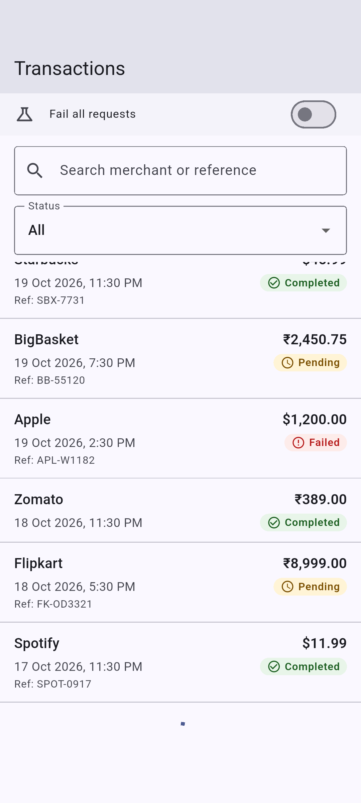 | 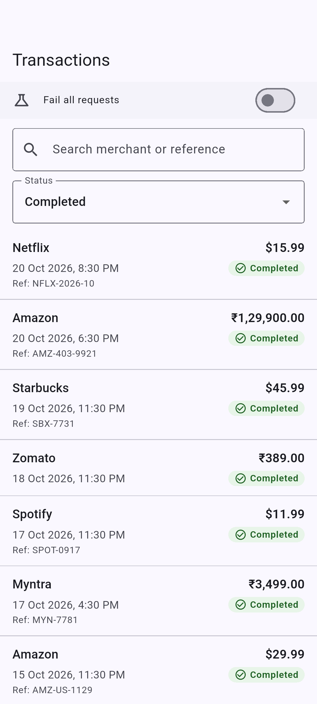 | 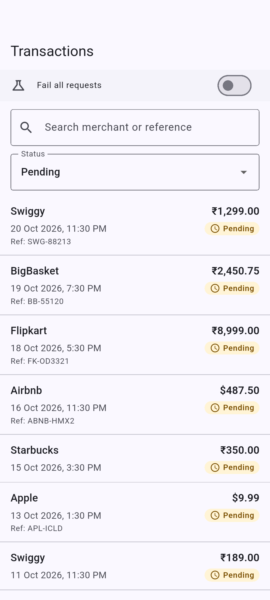 |

| Failed | All (saved, updating) | Rapid changes → Failed | Refreshed (Pending) |
| --- | --- | --- | --- |
| 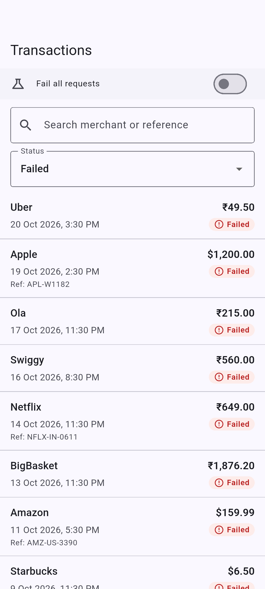 | 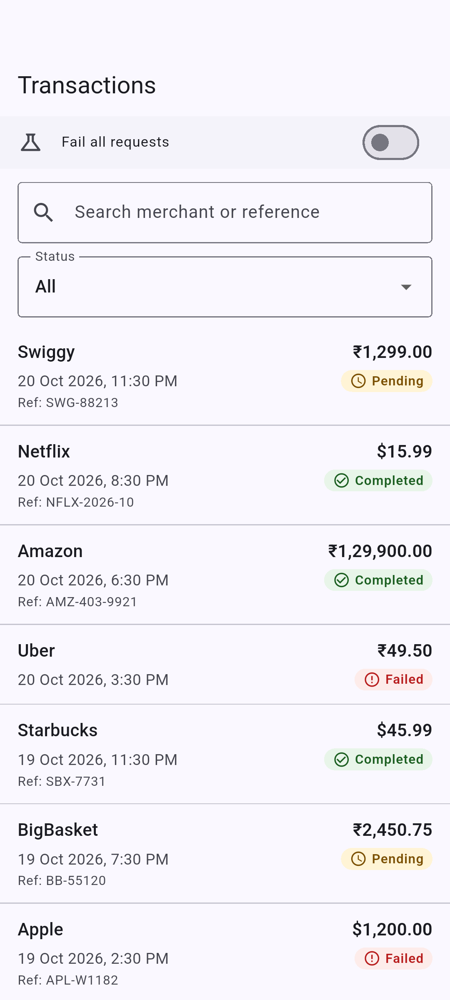 |  |  |

| Fail all requests on | First-page error | Next-page error | Refresh failure |
| --- | --- | --- | --- |
| 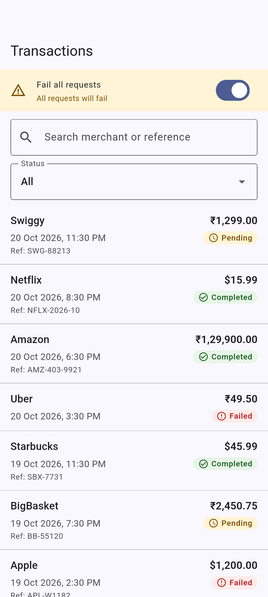 | 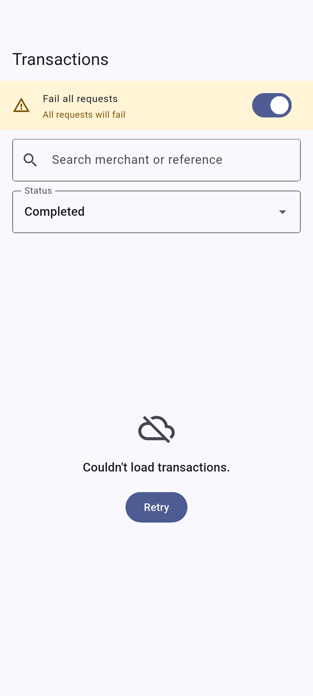 | 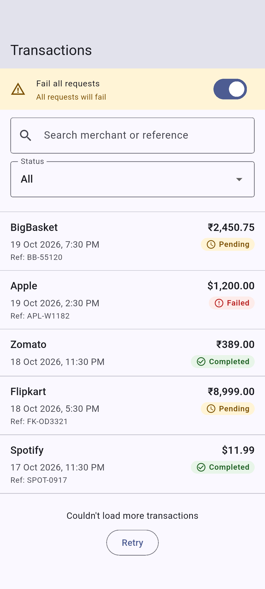 | 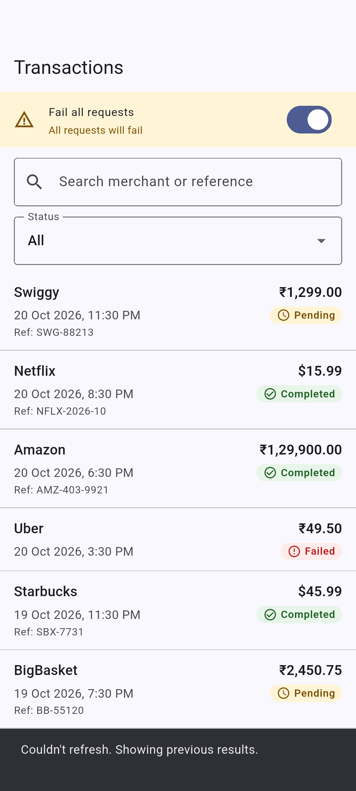 |

| Search "swig" | Search, no matches | Details | Empty state |
| --- | --- | --- | --- |
| 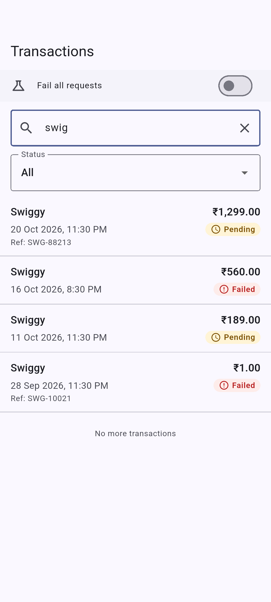 | 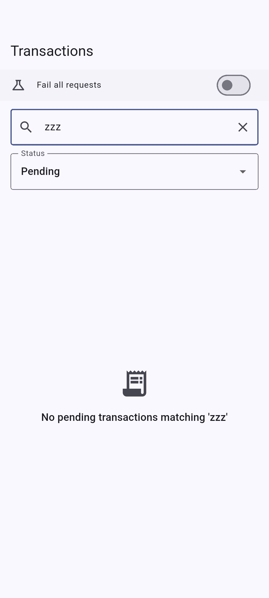 | 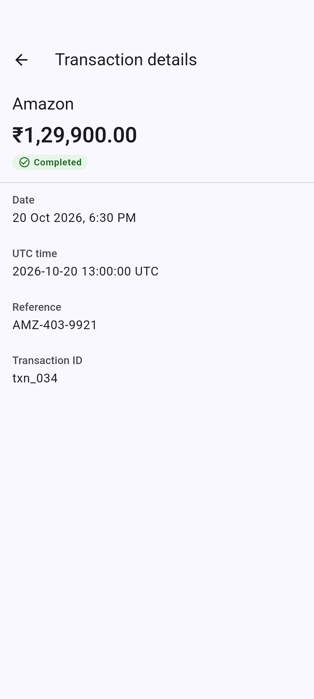 | 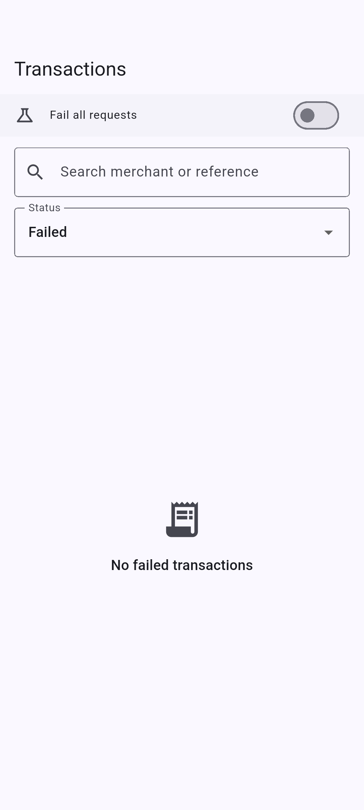 |

| Saved results, updating | Saved results, update failed | Large text (2.0) | Large text, Pending |
| --- | --- | --- | --- |
| 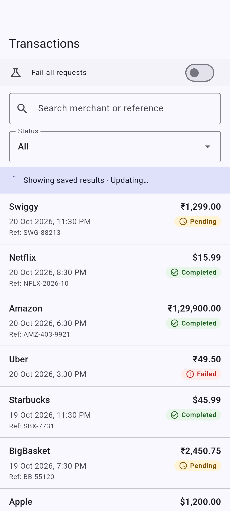 | 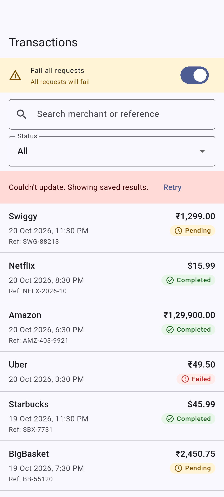 | 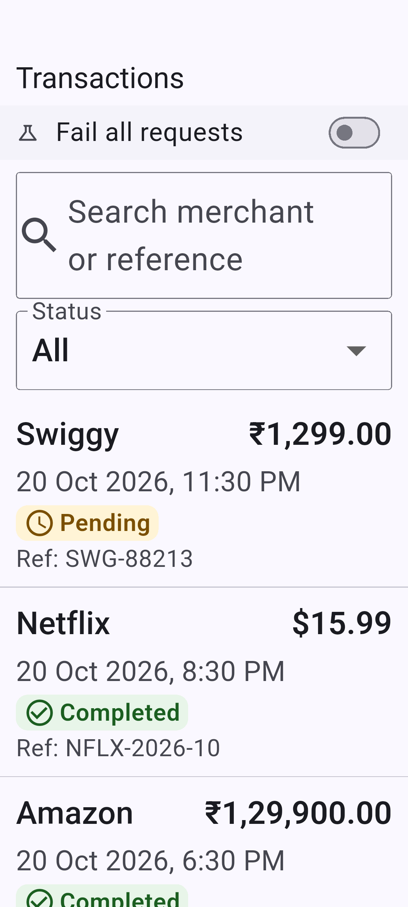 | 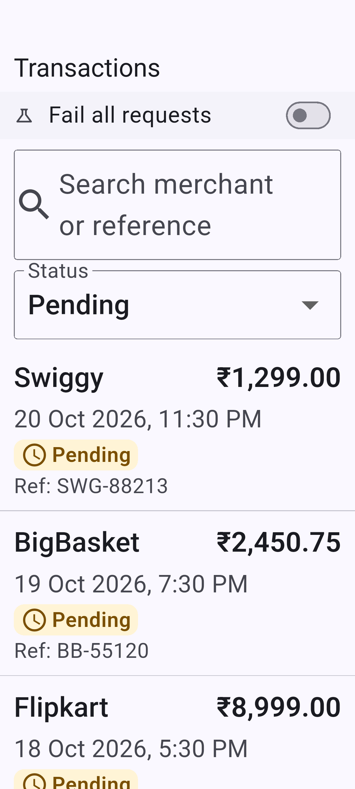 |

| Large text, details | System font scale 2.0 |
| --- | --- |
| 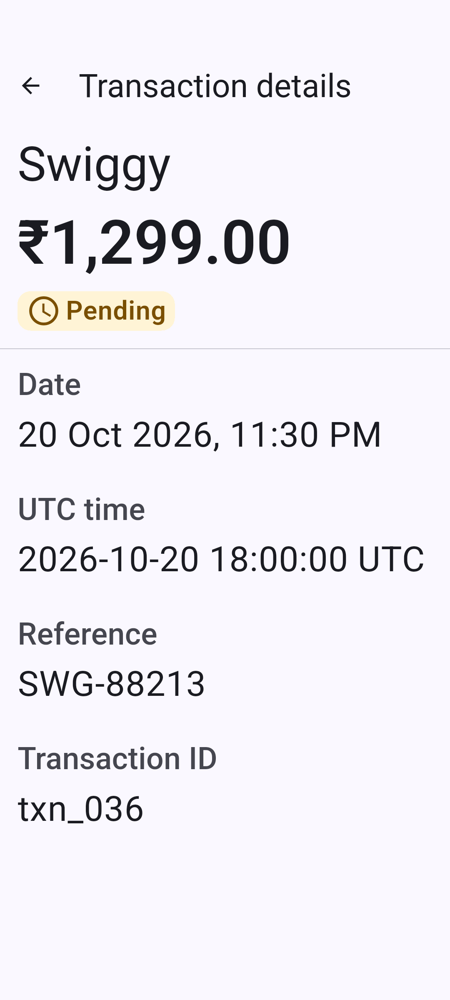 | 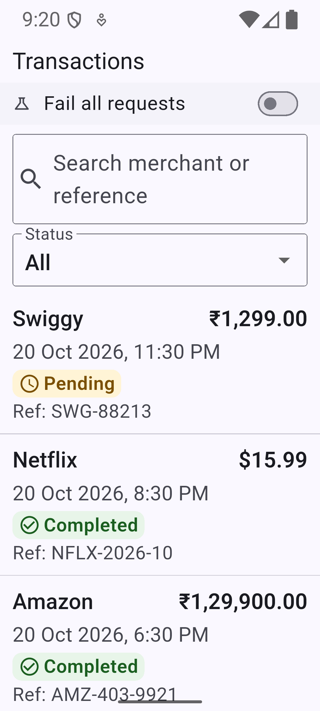 |
